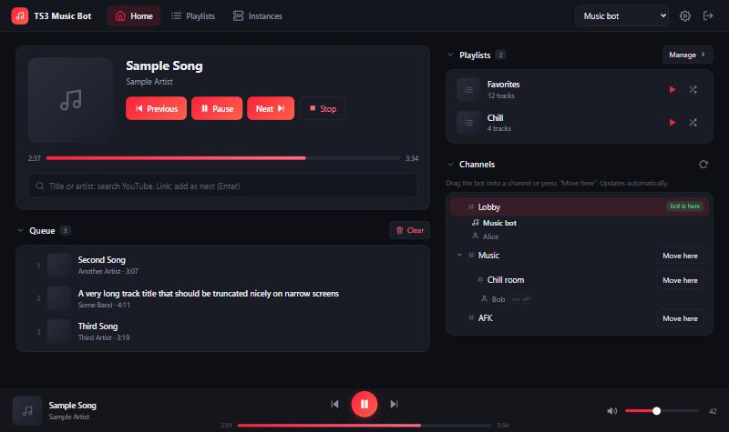
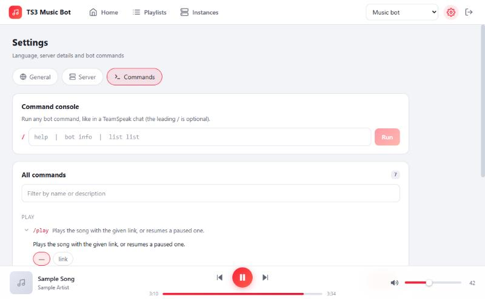
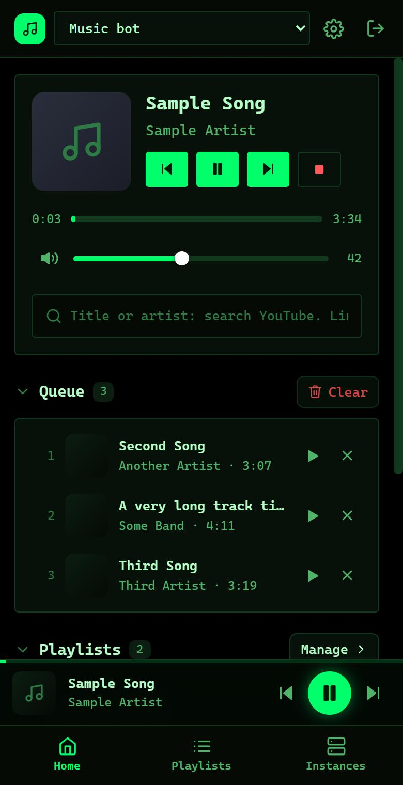

# TS3 Sound Bot

A music bot for TeamSpeak 3 with a modern web panel, easy installers and no Chinese-only leftovers. It is a set of patches and a new web
panel on top of the maintained [TS3AudioBot fork by goD0S](https://github.com/goD0S/TS3AudioBot), plus installers for Docker and for
Windows / Linux without Docker.

**English** | [Русский](#русская-версия)



## Features

- Plays YouTube (search by title or artist, links, playlists) and direct links; queue, playlists you create and edit in the panel.
- **Web panel** (Vue 3): player, queue, playlists, channel tree where you drag the bot to another channel, instances, server info,
  a console and a list of all commands with descriptions. Works on phones.
- **English / Russian** interface (add a language with one JSON file), **dark / light / hacker** themes, keyboard shortcuts. Bot chat replies follow the language chosen in the installer.
- **Delete the bot** button (Settings): removes a Docker-free install completely (autostart, settings, files).
- Commands in the TeamSpeak chat start with `/` (for example `/play <link>`, `/help`).
- Interactive installers (English / Russian) that ask for the server address, nickname, panel access and key.
- yt-dlp updates itself on every start (YouTube changes often).

| | |
|---|---|
|  |  |

## Install

Download an archive from the [Releases](../../releases) page, or build it yourself (see below).

| Archive | For whom | Needs |
|---|---|---|
| `*-docker-installer.zip` | Windows, Linux, macOS | [Docker](https://docs.docker.com/get-docker/) |
| `*-native-win-x64.zip` | Windows | nothing (ffmpeg is bundled, the installer downloads yt-dlp and deno) |
| `*-native-linux-x64.tar.gz` | Linux | `libicu` and `libopus0` (the installer checks and tells you) |

Unpack, run the installer (`install.cmd` / `install.ps1` / `install.sh`), answer the questions. Each archive has its own short README.
The panel is served over HTTPS with a self-signed certificate: the browser warns once, this is expected.

## Repository layout

| Folder | What it is |
|---|---|
| `bot/` | Patches applied to the upstream fork at build time (`patch*.sh`, `api-playlists.patch`) and `ApiTree.cs` with the extra API. |
| `webui/` | The web panel (Vue 3 + Vite). Translations: `webui/src/locales`. `npm run mock` + `npm run dev:mock` develop it without a bot. |
| `docker/` | Docker installer (Dockerfile, compose file, `install.ps1`, `install.sh`). |
| `native/` | Installers without Docker and the script that builds the packages (`native/build.ps1`). |
| `templates/` | Config templates used by the installers. |
| `scripts/` | `package.ps1` builds the release archives. |

## Build from source

```bash
# Docker installer straight from the repository
cd docker && ./install.sh          # or install.ps1 on Windows

# Release archives (needs Docker and PowerShell 5.1+ / pwsh)
pwsh scripts/package.ps1 -Version 1.0.0     # result in dist/
```

The bot itself is compiled from the pinned upstream commit (see `REF` in the Dockerfiles); the patches in `bot/` are written for that commit.

## Security notes

The panel has one shared access key. By default the installers make it reachable from the same computer only; choose "local network"
only on networks you trust, and put a reverse proxy with a real certificate in front of it before exposing it to the internet.
Never publish your `data/` folder (it holds the key, the bot identity and your server password).

## Acknowledgements

Huge thanks to **Splamy** and all contributors of [TS3AudioBot](https://github.com/Splamy/TS3AudioBot) - the original bot (and the TSLib
TeamSpeak library inside it) that this project is built on - and to **goD0S** for keeping it alive in the
[maintained fork](https://github.com/goD0S/TS3AudioBot). Without their work this project would not exist.
Thanks also to the authors of [yt-dlp](https://github.com/yt-dlp/yt-dlp), [deno](https://deno.com), [ffmpeg](https://ffmpeg.org),
[Vue](https://vuejs.org) and [Vite](https://vite.dev).

## Made with AI

This project was created with the help of an AI assistant (Claude by Anthropic) under the author's direction: the code, the installers
and the documentation were written and tested together with it. As with any software, read the code and test it before relying on it.

## Disclaimer

Not affiliated with or endorsed by TeamSpeak Systems or YouTube. TeamSpeak is a trademark of its owner. Playing content from YouTube may be
restricted by its terms of service in your country; use the bot responsibly and for personal, non-commercial purposes.

## Support the author

The bot is free. If it is useful to you and you want to say thanks: [DonationAlerts](https://www.donationalerts.com/r/chopor). Thank you!

## License and credits

Everything here is licensed under the [Open Software License 3.0](LICENSE), because it is built on, and derived from, the upstream
TS3AudioBot code (Splamy/TS3AudioBot, goD0S fork), which uses that license. See [NOTICE.md](NOTICE.md) for third-party components
(yt-dlp and deno are downloaded at install time; ffmpeg is installed with Docker or bundled unchanged into the Docker-free archives, with its own license in `licenses/ffmpeg/`).

---

<a id="русская-версия"></a>

# Русская версия

[↑ English](#ts3-sound-bot)

Музыкальный бот для TeamSpeak 3 с современной веб-панелью и простыми установщиками. Это набор патчей и новая веб-панель поверх
поддерживаемого [форка TS3AudioBot от goD0S](https://github.com/goD0S/TS3AudioBot), плюс установщики с Docker и без него
(Windows / Linux).

## Возможности

- Играет YouTube (поиск по названию или исполнителю, ссылки, плейлисты) и прямые ссылки; очередь, плейлисты, которые создаются и правятся в панели.
- **Веб-панель** (Vue 3): плеер, очередь, плейлисты, дерево каналов (бота можно перетащить в другой канал), экземпляры, данные сервера,
  консоль и список всех команд с описаниями. Удобна с телефона.
- Интерфейс **на английском и русском** (новый язык - один JSON-файл), темы **тёмная / светлая / хакерская**, горячие клавиши.
  Ответы бота в чате TeamSpeak - на языке, выбранном в установщике.
- Кнопка **«Удалить бота»** (Настройки): полностью удаляет установку без Docker (автозапуск, настройки, файлы).
- Команды в чате TeamSpeak начинаются с `/` (например `/play <ссылка>`, `/help`).
- Интерактивные установщики (английский / русский): спрашивают адрес сервера, ник, доступ к панели и ключ.
- yt-dlp обновляется при каждом запуске (YouTube часто меняет защиту).

## Установка

Скачайте архив на странице [Releases](../../releases) или соберите сами (см. ниже).

| Архив | Для кого | Что нужно |
|---|---|---|
| `*-docker-installer.zip` | Windows, Linux, macOS | [Docker](https://docs.docker.com/get-docker/) |
| `*-native-win-x64.zip` | Windows | ничего (ffmpeg встроен, установщик скачает yt-dlp и deno) |
| `*-native-linux-x64.tar.gz` | Linux | `libicu` и `libopus0` (установщик проверит и подскажет) |

Распакуйте, запустите установщик (`install.cmd` / `install.ps1` / `install.sh`), ответьте на вопросы. В каждом архиве есть свой короткий README.
Панель работает по HTTPS с самоподписанным сертификатом: браузер один раз предупредит, так и должно быть.

## Структура репозитория

| Папка | Что это |
|---|---|
| `bot/` | Патчи к исходному форку, применяются при сборке (`patch*.sh`, `api-playlists.patch`), и `ApiTree.cs` с дополнительным API. |
| `webui/` | Веб-панель (Vue 3 + Vite). Переводы: `webui/src/locales`. `npm run mock` + `npm run dev:mock` - разработка без бота. |
| `docker/` | Установщик с Docker (Dockerfile, compose, `install.ps1`, `install.sh`). |
| `native/` | Установщики без Docker и скрипт сборки пакетов (`native/build.ps1`). |
| `templates/` | Шаблоны конфигов для установщиков. |
| `scripts/` | `package.ps1` собирает архивы для релиза. |

## Сборка из исходников

```bash
# Docker-установщик прямо из репозитория
cd docker && ./install.sh          # или install.ps1 в Windows

# Архивы для релиза (нужны Docker и PowerShell 5.1+ / pwsh)
pwsh scripts/package.ps1 -Version 1.0.0     # результат в dist/
```

Сам бот компилируется из закреплённого коммита оригинала (`REF` в Dockerfile); патчи в `bot/` написаны под этот коммит.

## Безопасность

У панели один общий ключ доступа. По умолчанию установщики открывают её только на этом же компьютере; режим «локальная сеть» выбирайте
только в доверенных сетях, а перед выходом в интернет поставьте перед панелью обратный прокси с настоящим сертификатом.
Никогда не публикуйте папку `data/` (в ней ключ, личность бота и пароль вашего сервера).

## Благодарности

Огромное спасибо **Splamy** и всем участникам [TS3AudioBot](https://github.com/Splamy/TS3AudioBot) - оригинального бота (и библиотеки TSLib
для TeamSpeak внутри него), на котором построен этот проект, и **goD0S** за то, что поддерживает его
в [живом форке](https://github.com/goD0S/TS3AudioBot). Без их работы этого проекта не было бы.
Спасибо и авторам [yt-dlp](https://github.com/yt-dlp/yt-dlp), [deno](https://deno.com), [ffmpeg](https://ffmpeg.org),
[Vue](https://vuejs.org) и [Vite](https://vite.dev).

## Создано с помощью нейросети

Проект создан с помощью нейросети (Claude от Anthropic) под руководством автора: код, установщики и документация написаны и проверены
совместно с ней. Как и любое другое ПО, прочитайте код и проверьте его, прежде чем на него полагаться.

## Отказ от ответственности

Проект не связан с TeamSpeak Systems и YouTube и не одобрен ими. TeamSpeak - товарный знак его владельца. Воспроизведение контента
YouTube может ограничиваться его условиями использования в вашей стране; используйте бота ответственно и для личных некоммерческих целей.

## Поддержать автора

Бот бесплатный. Если он вам пригодился и хочется сказать спасибо: [DonationAlerts](https://www.donationalerts.com/r/chopor). Спасибо!

## Лицензия

Всё здесь распространяется по [Open Software License 3.0](LICENSE): проект построен на коде TS3AudioBot (Splamy/TS3AudioBot, форк goD0S)
и является его производной работой, а у оригинала именно эта лицензия. Сторонние компоненты - в [NOTICE.md](NOTICE.md).
